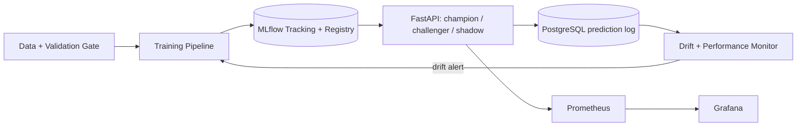

# 🧠 End-to-End MLOps Platform with Model Drift Detection

A mini production ML platform: **train → track → register → deploy → monitor → detect drift → retrain.**

> Build status: **Part 1 / 8 complete** ✅

```
PART 1  ████████████████████████████████  Foundation: data, validation, training, tracking   ✅
PART 2  ░░░░░░░░░░░░░░░░░░░░░░░░░░░░░░░░  Model registry + champion/challenger promotion
PART 3  ░░░░░░░░░░░░░░░░░░░░░░░░░░░░░░░░  FastAPI serving + PostgreSQL prediction logging
PART 4  ░░░░░░░░░░░░░░░░░░░░░░░░░░░░░░░░  A/B testing + shadow deployment
PART 5  ░░░░░░░░░░░░░░░░░░░░░░░░░░░░░░░░  Drift detection + performance monitoring + auto-retrain
PART 6  ░░░░░░░░░░░░░░░░░░░░░░░░░░░░░░░░  Prometheus + Grafana dashboards
PART 7  ░░░░░░░░░░░░░░░░░░░░░░░░░░░░░░░░  Docker Compose full stack
PART 8  ░░░░░░░░░░░░░░░░░░░░░░░░░░░░░░░░  GitHub Actions CI/CD + docs polish
```

## Target architecture



## What Part 1 delivers

| Capability | Where |
|---|---|
| Synthetic churn data with **controllable covariate + concept drift** (4 scenarios) | `src/mlops/data/generator.py` |
| **Data contract** (YAML) + automated validation with structured, severity-ranked checks | `configs/config.yaml`, `data/validation.py` |
| **Reference profile** (quantile bins, frequencies, KS sample) saved with every model, the baseline for drift detection in Part 5 | `data/profile.py` |
| Training pipeline: validate → split → 3 candidates (nested MLflow runs) → CV-based selection → **quality gate** → signed model | `training/pipeline.py` |
| Reproducibility: data hash, seed, config, validation report, profile all logged to MLflow | `training/pipeline.py` |
| Rich CLI with live progress bar and leaderboard | `cli.py` |
| 10 unit/integration tests | `tests/` |

### Design decisions worth talking about in interviews
* **Fail fast on bad data.** Validation runs *before* any training; rejected runs are still logged to MLflow with `pipeline_status=rejected_bad_data`, so you have an audit trail.
* **Select on CV, report on holdout.** The test set never influences model choice.
* **Quality gate.** A model below `min_auc_to_accept` is never logged as a deployable artifact.
* **Per-model baselines.** The reference profile travels with the model so drift is measured against what *that* model saw.

## Quickstart

```bash
python -m venv .venv && source .venv/bin/activate
make install
make data                   # generate data/train.csv
make train                  # full pipeline with progress bar
make test                   # 10 tests
make ui                     # MLflow UI on http://localhost:5000
```

Try the data gate:
```bash
python -m mlops.cli generate --scenario severe_drift --out data/drifted.csv
python -m mlops.cli validate data/drifted.csv -v
```
(Run commands with `PYTHONPATH=src`, which the Makefile sets for you.)
