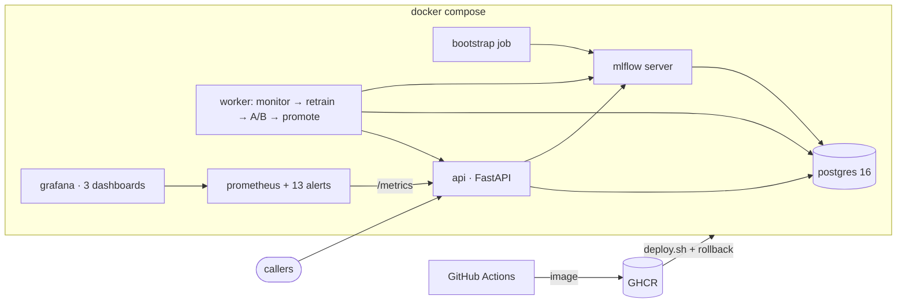
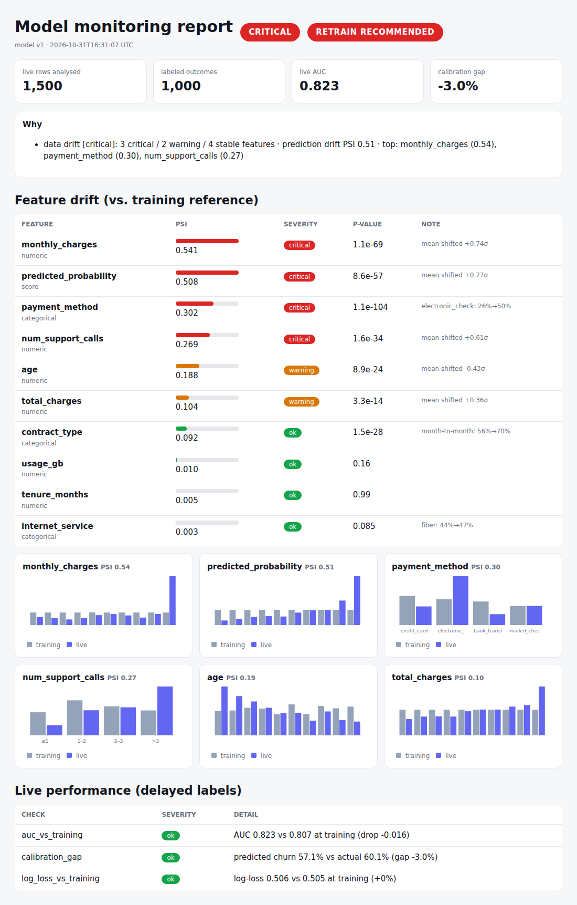

# End-to-End MLOps Platform with Model Drift Detection

A mini production ML platform that **trains, tracks, deploys, monitors, and safely updates** a churn model: detecting when real-world data changes
enough to hurt performance, and (within guard-rails) retraining and promoting a better model on its own.

> *Many candidates can train a model. Fewer demonstrate how to version, deploy, monitor, and safely update one.* This repo is about the second part.

```
healthy ──► market shifts ──► drift detected ──► waits for labels ──► retrains on production data
        ──► SHADOW (zero user risk) ──► A/B 20 % (sample-ratio + guardrails) ──► promoted ──► healthy again      (make demo-lifecycle)
```

## What it covers (mapped to the brief)
| Requirement | Where it lives |
|---|---|
| **Automated data validation + training pipelines** | YAML data contract → validation gate → N candidates (nested MLflow runs) → CV selection → quality gate · `src/mlops/data`, `training` |
| **Experiment tracking + model registry** | MLflow (Postgres backend, proxied artifacts); champion/challenger aliases, audit tags, rollback · `src/mlops/registry` |
| **A/B testing / shadow deployment** | Shadow mirroring, sticky A/B routing, paired + independent-arms statistics, SRM check, auto-conclusion · `src/mlops/experiments`, `serving` |
| **Data drift + prediction-quality monitoring** | PSI/KS/χ²/missing-rate + prediction drift (no labels); AUC/log-loss/calibration on delayed labels · `src/mlops/monitoring` |
| **CI/CD that tests and deploys a model API** | GitHub Actions: lint → infra validation → tests (real Postgres) → **model-quality gate** → full-stack smoke → GHCR publish → gated deploy with auto-rollback · `.github/workflows`, `scripts/` |
| **Prometheus / Grafana** | `/metrics`, 13 alert rules, 3 provisioned dashboards (40 panels) · `deploy/` |
| **PostgreSQL** | prediction log, labels, monitoring runs, rollout state, audit timeline · `serving/db.py` |
| **Docker** | one hardened multi-stage image; compose stack with ordered, health-gated startup · `Dockerfile`, `docker-compose*.yml` |
| Tech stack | Python · scikit-learn (XGBoost not wired in) · MLflow · FastAPI · Docker · GitHub Actions · Prometheus/Grafana · PostgreSQL |

## Architecture

Details, trade-offs and failure modes: **[docs/DESIGN.md](docs/DESIGN.md)** · operations: **[docs/RUNBOOK.md](docs/RUNBOOK.md)** · talking points: **[docs/INTERVIEW_GUIDE.md](docs/INTERVIEW_GUIDE.md)**.

## Try it
```bash
pip install -r requirements-dev.txt -c constraints.txt        # locked, reproducible versions
make demo-lifecycle     # the whole story, hands-off, about a minute, no Docker needed
make test               # 119 tests
make help               # every command, documented
```
**Full stack in Docker** (API · worker · MLflow · Postgres · Prometheus · Grafana):
```bash
make up-demo            # builds one image; a traffic generator drifts after 2 min and the platform heals itself
make smoke              # API + MLflow + Prometheus + Grafana checks
```
| URL | |
|---|---|
| http://localhost:8000/docs | API (mutating endpoints need `X-Admin-Token`) |
| http://localhost:3000 | Grafana: *Service health* · *Model quality & drift* · *Rollouts & lifecycle* |
| http://localhost:5000 | MLflow |
| http://localhost:9090 | Prometheus + alerts |

Other demos: `make demo` (registry: promote / reject / roll back) · `make demo-deploy` (shadow + A/B verdicts) · `make monitor` (HTML drift report).



## What the project taught me (and the tests prove)
* **Concept drift is invisible to feature monitors.** Inputs unchanged, outcomes shifted: only calibration monitoring catches it.
* **A model's own test split can't be trusted.** One candidate scored AUC 0.91 on its own split and 0.73 on the shared golden set.
* **Automation needs brakes.** The orchestrator refuses to retrain on data that violates the contract: that's an incident, not a lesson.
* **Validate with the real thing.** Running real tools caught bugs that parsing couldn't: a race between prediction logging and feedback, dashboard queries that returned nothing, YAML that would have broken CI.

## CI/CD
| Workflow | Does |
|---|---|
| **CI** (`ci.yml`) | `lint` (ruff, shellcheck, actionlint) · `infra` (promtool on config/alerts/*every dashboard query*, hadolint, compose incl. prod override, dashboards in sync) · `test` (pytest incl. **real PostgreSQL**) · `model-gate` (below) · `smoke` (compose up + `scripts/smoke_test.py` vs API/MLflow/Prometheus/Grafana) · `publish` (GHCR, SBOM + provenance, Trivy report) |
| **Deploy** (`deploy.yml`) | manual or `v*` tag; protected `production` environment; rsync → `scripts/deploy.sh` (pull first, health-gated, **automatic rollback**) → read-only smoke test → rollback if it fails |
| **Nightly** | newest dependency versions + the full lifecycle demo, to catch upstream breakage early |

**Model CI** (`scripts/model_ci.py`) is a regression test for the *training code*: data-contract positive **and negative** control · AUC/Brier vs committed
`ci/baseline_metrics.json` · calibration on a golden set · worst-segment AUC · bit-for-bit reproducibility · latency budget. It is tested to **fail** on injected regressions.

## Verification (what I did and did not do)
I built this in a sandbox with no Docker daemon and no GitHub, so I validated against real components instead of assuming:
* full test suite on a **clean-room install of the newest dependency versions** (pandas 3, scikit-learn 1.9, numpy 2.5)
* **real PostgreSQL 16** (incl. 6 replicas creating tables simultaneously), a **real MLflow server**, and a **real Prometheus** scraping the API through a full drift → retrain → A/B → promote cycle; all dashboard queries executed against it
* `promtool`, `hadolint`, `shellcheck`, `actionlint`, `docker compose config` (incl. the production override)
* the smoke test against the stack, in healthy and failing conditions; the deploy script against a fake `docker`; the model gate in both directions

**Not executed here:** the GitHub Actions runs themselves, `docker build`/container runtime, Grafana rendering, GHCR publish, an SSH deploy. They are linted and each step's logic was exercised locally, but run `make up` and push to GitHub to close that gap.
Limitations (synthetic data, univariate drift, pickled models, single node, …) are listed honestly in [docs/DESIGN.md §6](docs/DESIGN.md).

## Layout
```
src/mlops/   data/ training/ registry/ serving/ experiments/ monitoring/   orchestrator.py  bootstrap.py  retention.py  cli*.py  demo.py
configs/     config.yaml: the data contract, thresholds, policies (single source of truth)
deploy/      prometheus/ (config, alerts)  grafana/ (provisioning, generated dashboards)  postgres/
scripts/     model_ci.py  smoke_test.py  deploy.sh  build_dashboards.py  validate_observability.py
ci/          baseline_metrics.json          .github/  workflows + dependabot
docs/        DESIGN  RUNBOOK  INTERVIEW_GUIDE
tests/       119 tests: unit, integration, Postgres, deploy-script, model-CI, docs consistency
```
MIT licensed.
