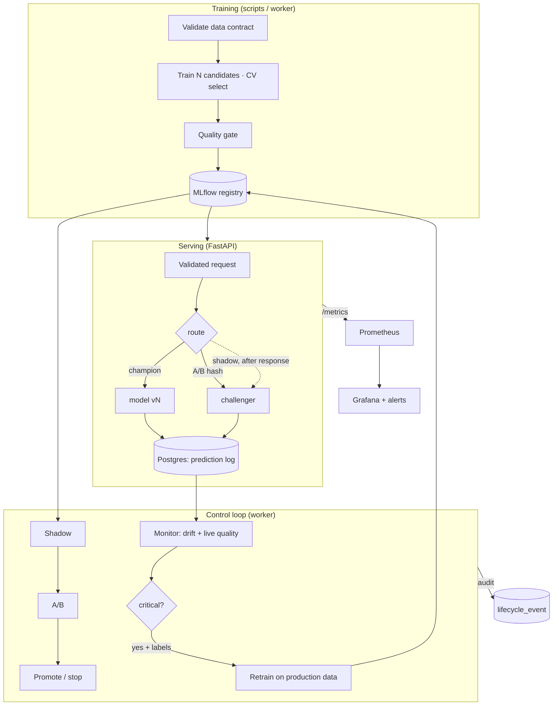

# Design

## 1. Goal
Show the part of ML that is hard and rarely demonstrated: **safely changing a model in production**. Training a model is one script; this project is
everything around it: versioning, validated inputs, safe rollout, monitoring, drift detection, automatic and *bounded* retraining, and the CI/CD to ship it.

**Non-goals:** state-of-the-art modelling, feature stores, GPU serving, multi-region HA, a UI beyond Grafana.

## 2. System

**State lives in two places only:** MLflow (models, versions, aliases) and Postgres (predictions, labels, monitoring runs, rollout state, audit events).
API replicas and the worker are stateless, so any of them can restart at any time.

## 2.1 Rollout state machine
`champion_only → shadow → ab → (promote | stop) → champion_only`. Every transition is guarded (safety floor, ≤ 50 % exposure, sample-size and SRM checks, timeouts) and logged.

## 3. Key decisions
| Decision | Alternatives | Why |
|---|---|---|
| **Primary online metric = log-loss** | accuracy, AUC | Concept drift breaks *calibration* first while AUC survives (observed in the simulator). Log-loss is continuous, so t-tests apply. |
| **Shadow before A/B** | A/B only | Shadow is a *paired* comparison on identical requests (needs far less data) and has zero user risk. A/B then only confirms. |
| **Judge on a fixed golden set offline, but online evidence decides** | strict offline gate always | A golden set can't judge a model trained for *today's* world. It stays as a safety floor (AUC ≥ 0.70) before any live exposure. |
| **Drift severity by PSI (effect size), not p-values** | KS/chi² p-values | With thousands of rows every shift is "significant". KS/χ² are reported but don't drive severity. |
| **Both data-drift and label-based monitoring** | one of them | Covariate drift needs no labels (early warning); concept drift is invisible to feature monitors (proved in tests). |
| **Per-model reference profile stored in MLflow** | one global baseline | Each model is monitored against the data *it* was trained on; a promoted model gets a fresh baseline automatically. |
| **Request schema generated from the data contract** | hand-written Pydantic | One source of truth for training validation, API validation and OpenAPI docs. |
| **Prediction logging in a background task** | synchronous insert | DB latency never reaches the caller. Cost: feedback can race the write, handled with a short grace period (found by the smoke test). |
| **Platform-state metrics computed at scrape time from the DB** | push from worker | The worker is a different process; DB-backed gauges are correct on every replica without a pushgateway. |
| **Sticky hash bucketing** | random per request | A customer must not flip between models; stateless and identical across replicas. |
| **Automation with brakes** | retrain on every alert | Waits for labels, refuses contract-violating data, cooldown, quality gate, experiment timeout, retention. |
| **MLflow aliases (champion / challenger)** | registry stages | Stages are deprecated; aliases are explicit and atomic. Rollback is a chain of `replaced_version` tags, no external state. |
| **One image, many roles** | image per service | One dependency set and one build; roles differ only by command. |

## 4. Failure modes
| Failure | Behaviour |
|---|---|
| Challenger throws during A/B | request transparently answered by champion; counted; alert; experiment invalid |
| Shadow challenger throws | recorded, never raised; verdict `unhealthy`; worker stops the experiment |
| MLflow down | API keeps serving the loaded champion; reload fails safely; bootstrap/worker retry |
| Postgres down | predictions still returned (logged after response, failures contained); `/stats` etc. fail; alert fires |
| Worker down | serving unaffected; `MonitoringStale` alert; no retraining until restored |
| Bad production data | monitor flags it; retraining refused by the data-contract gate; alert `AutoRetrainBlocked` |
| Bad release | `deploy.sh` rolls back automatically if `/ready` never turns healthy |
| Bad model | A/B/shadow verdicts block it; `registry rollback` reverts a promoted one |
| Replicas boot simultaneously | Postgres advisory lock serialises `CREATE TABLE` |
| Experiment never concludes | stopped after `max_duration_hours` |

## 5. Security model
Mutating endpoints need `X-Admin-Token`; reads stay open (put the API behind your gateway). Postgres/MLflow/Prometheus bind to localhost;
containers run as non-root; secrets come from `.env` and production compose **refuses to start** without them; CI downloads third-party tools by pinned SHA-256.
**Caveats:** models are pickled (cloudpickle): only load artifacts from a registry you trust; MLflow itself has no auth enabled here.

## 6. Limitations (read before claiming anything)
* **Synthetic data.** Effects are large by design; real drift is subtler and slower, so thresholds (PSI 0.10/0.25, calibration ±5/10 pts, sample sizes) must be tuned per use case.
* **scikit-learn only** (logistic regression / random forest / gradient boosting). The pipeline is model-agnostic, but XGBoost is not wired in.
* **Univariate drift only** (per feature + score). No multivariate/embedding drift, no fairness monitoring beyond a slice check in model CI.
* **Delayed labels & peeking.** Churn labels take weeks; the min-sample gate mitigates but does not eliminate peeking/multiple-testing inflation. Sequential testing would be the upgrade.
* **Feedback loops.** Retraining on production labels can reinforce the model's own decisions (e.g. retention offers change who churns). Not modelled here.
* **Single node.** Compose, one Postgres, no HA, no TLS (put Caddy/nginx in front), no SSO. `create_all` instead of migrations (Alembic is the next step).
* **Counters reset on restart** (one uvicorn worker per container; scale with replicas). Retention uses `DELETE`, not partitions.
* **Not executed in my build sandbox:** the GitHub Actions workflows themselves (linted with actionlint; every step's logic exercised locally), `docker build`/container runtime, Grafana rendering, GHCR push / Trivy, SSH deploy to a real host.

## 7. What I'd do next
Alembic migrations · Postgres partitioning · sequential testing (mSPRT) · multivariate drift (domain classifier) · a real feature store · OIDC auth + MLflow auth ·
canary by region · cost-aware promotion (business metric, not just log-loss) · signed model artifacts.
